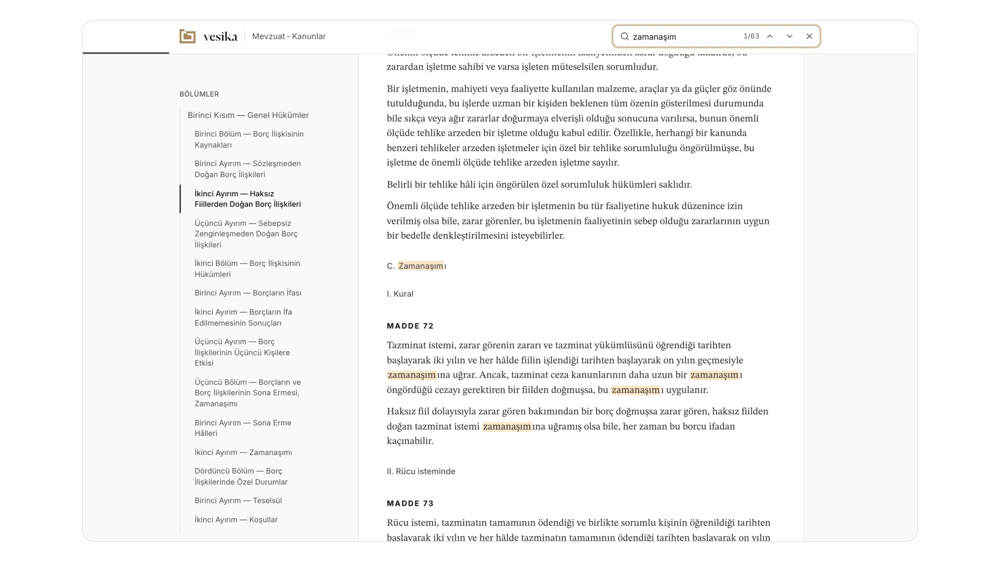

import demo from "../posts/jetpack-compose-ile-declarative-ui-gelistirme/demo.mp4";
import poster from "../posts/jetpack-compose-ile-declarative-ui-gelistirme/poster.webp";
import moodstoneCover from "../projects/moodstone/cover.png";
import moods from "../projects/moodstone/moods.png";
import moodsDark from "../projects/moodstone/moods-dark.png";
import studio from "../projects/moodstone/studio.png";
import studioDark from "../projects/moodstone/studio-dark.png";
import vesikaAssistant from "../projects/vesika/assistant.png";
import compass from "./components/compass.png";
import compassDark from "./components/compass-dark.png";
import countdown from "./components/countdown.png";
import countdownDark from "./components/countdown-dark.png";
import etnospor1 from "./components/etnospor-1.png";
import etnospor2 from "./components/etnospor-2.png";
import etnospor3 from "./components/etnospor-3.png";
import etnospor4 from "./components/etnospor-4.png";
import home from "./components/home.png";
import homeDark from "./components/home-dark.png";
import kilowatt1 from "./components/kilowatt-1.png";
import kilowatt2 from "./components/kilowatt-2.png";
import kilowatt3 from "./components/kilowatt-3.png";
import kilowatt4 from "./components/kilowatt-4.png";
import locations from "./components/locations.png";
import locationsDark from "./components/locations-dark.png";
import reminders from "./components/reminders.png";
import remindersDark from "./components/reminders-dark.png";
import settings from "./components/settings.png";
import settingsDark from "./components/settings-dark.png";

<Section as="header" title="Components">
<Prose>

Every important component on one page, filled with real screenshots and content, so a change can be judged in one place. This page only exists in `pnpm dev` and is never built.

</Prose>
</Section>

<Section label="highlights">
<Prose>

Up to four numbers under a project's description, from the `highlights` field, each a value with a short label. Four columns on wide screens and two on phones. A single highlight keeps the same column width.

</Prose>
<Highlights items={props.highlights} />
<Highlights items={props.highlights.slice(0, 1)} />
</Section>

<Section label="gallery">
<Prose>

Wide screenshots at the top of a project page, from the `gallery` field. One slide at a time, each with a caption and an optional dark version. These three show a light-only image, a light and dark pair, and a web app.

</Prose>
<Gallery
  title="Gallery"
  slides={[
    {
      src: moodstoneCover,
      alt: "Rows of Moodstone avatars on a dark navy background, in every cut, mood and palette color.",
      caption: "A light-only slide.",
    },
    {
      src: moods,
      dark: moodsDark,
      alt: "The nine Moodstone moods side by side, each on a different cut and color.",
      caption: "A slide with a dark version.",
    },
    {
      src: vesikaAssistant,
      alt: "A Vesika answer in Turkish with numbered citations and a list of sources, next to the cited article open in a side panel.",
      caption: "A web app screenshot.",
    },
  ]}
/>
</Section>

<Section label="screens">
<Prose>

Phone screenshots at the top of a project page, from the `screens` field. Each screen is its own image with an optional dark version and a caption. Six screens are more than fit, so the row scrolls at full size and the arrows appear.

</Prose>
<Screens
  title="Vakitler"
  eager
  screens={[
    {
      src: home,
      dark: homeDark,
      alt: "The Vakitler home screen counting down ten minutes to Asr, with the six prayer times below and Asr outlined.",
      caption: "Home, ten minutes to Asr.",
    },
    {
      src: locations,
      dark: locationsDark,
      alt: "The saved locations sheet over the home screen, listing Cankaya, Kadikoy and Basaksehir, with a button to add a location.",
      caption: "Saved locations.",
    },
    {
      src: settings,
      dark: settingsDark,
      alt: "The settings screen with prayer times, location, reminders, iftar countdown, theme, language and about sections.",
      caption: "Settings.",
    },
    {
      src: reminders,
      dark: remindersDark,
      alt: "The reminders screen with a toggle and a lead time for each of the six prayers.",
      caption: "A reminder for each prayer.",
    },
    {
      src: countdown,
      dark: countdownDark,
      alt: "The onboarding page about the countdown, reading Keep the next prayer in sight.",
      caption: "Onboarding, the countdown.",
    },
    {
      src: compass,
      dark: compassDark,
      alt: "The onboarding page asking Where are you praying, with buttons to use the device location or choose from a list.",
      caption: "Onboarding, your location.",
    },
  ]}
/>
</Section>

<Section label="screens in text">
<Prose>

The same component inside a project's text. Four Kilowatt store screenshots fit on one line, so there are no arrows.

<Screens
  title="Kilowatt store set"
  screens={[
    {
      src: kilowatt1,
      alt: "Kilowatt store screenshot in Turkish about the whole charging network in your pocket.",
    },
    {
      src: kilowatt2,
      alt: "Kilowatt store screenshot in Turkish about finding a nearby station on the map.",
    },
    {
      src: kilowatt3,
      alt: "Kilowatt store screenshot in Turkish about station details with sockets.",
    },
    {
      src: kilowatt4,
      alt: "Kilowatt store screenshot in Turkish about station photos and reviews.",
    },
  ]}
/>

Four Etnospor store screenshots in the older 9:16 shape. The row shrinks a little so all four still fit, and each screen has its year as a caption.

<Screens
  title="Etnospor store set"
  screens={[
    {
      src: etnospor1,
      alt: "An Aba wrestling event with its date, a map and a join button, in Turkish.",
      caption: "2021",
    },
    {
      src: etnospor2,
      alt: "The 6th Ethnosport Culture Festival splash screen on a phone held in a hand.",
      caption: "2024",
    },
    {
      src: etnospor3,
      alt: "The points leaderboard, in Turkish.",
      caption: "2024",
    },
    {
      src: etnospor4,
      alt: "The home screen with tiles for the QR code, the event calendar, the festival area, the leaderboard and announcements, in Turkish.",
      caption: "2025",
    },
  ]}
/>

</Prose>
</Section>

<Section label="screenshot">
<Prose>

One wide image inside a project's text, with an optional dark version and a caption.

<Screenshot
  src={studio}
  dark={studioDark}
  alt="The Moodstone Studio with a sky blue hexagon in the thinking mood, controls for mood, motion, cut, color and tuning, and the matching code below the preview."
  caption="The Moodstone Studio, with a light and dark pair."
/>

</Prose>
</Section>

<Section label="markdown image">
<Prose>

A plain Markdown image also takes the full wide width, but has no caption or dark version.



</Prose>
</Section>

<Section label="screen recording">
<Prose>

A video for an interaction that screenshots can't show, capped at a phone's width.

<video
  src={demo}
  poster={poster.src}
  width="600"
  height="1144"
  controls
  playsinline
  preload="none"
  aria-label="Screen recording of a small color picker app built with Jetpack Compose"
/>

</Prose>
</Section>

<Section label="platform links">
<Prose>

Labelled under a project's years and company, faint icons that brighten on hover in list rows, and a quiet label when a project isn't live.

</Prose>
<PlatformLinks project={props.live} labelled />
<PlatformLinks project={props.live} />
<PlatformLinks project={props.offline} />
</Section>

<Section label="chips">
<Prose>

Chips sit inside a sentence. Some are plain, like <Chip icon="kotlin">Kotlin</Chip> and <Chip icon="compose">Jetpack Compose</Chip>. Others link out, like <Chip icon="wite" href="https://wite.com.tr">Wite</Chip>, or to a project, like <Chip icon="moodstone" href="/projects/moodstone">Moodstone</Chip>.

</Prose>
</Section>

<Section label="text">
<Prose>

Body text with a [link](https://github.com/karacca), **bold**, _italic_ and `inline code`.

## A second-level heading

Text under a section heading.

### A third-level heading

- **Countdown.** A large timer until the next prayer.
- **Reminders.** A notification before the prayers you choose.
- **Widgets.** The next prayer on the home screen.

1. Pick a location.
2. Turn on reminders.
3. Add a widget.

> The home screen answers one question: how long until the next prayer.

```kotlin
@Composable
fun Countdown(remaining: Duration, modifier: Modifier = Modifier) {
    Text(
        text = remaining.format(),
        style = MaterialTheme.typography.displayLarge,
        modifier = modifier,
    )
}
```

| Prayer  | Time  | Reminder          |
| ------- | ----- | ----------------- |
| Fajr    | 06:28 | 1 hour before     |
| Dhuhr   | 12:59 | 30 minutes before |
| Maghrib | 17:43 | 45 minutes before |

---

The line above is a divider.

</Prose>
</Section>

<Section label="project list">
  <ProjectList projects={props.projects.slice(0, 4)} />
</Section>

<Section label="post list">
  <PostList posts={props.posts.slice(0, 3)} />
</Section>

<Section label="activity">
  <ContributionsChart caption="Fig. 1. {count} contributions on GitHub between {from} and {to}." />
</Section>

<Section label="signature">
  <Signature />
</Section>

<Section label="actions">
  <Actions />
</Section>
